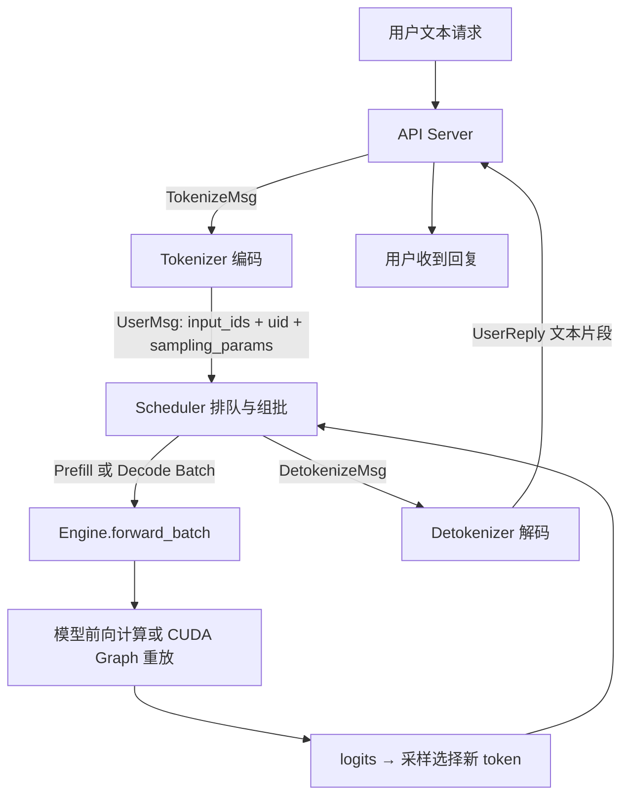
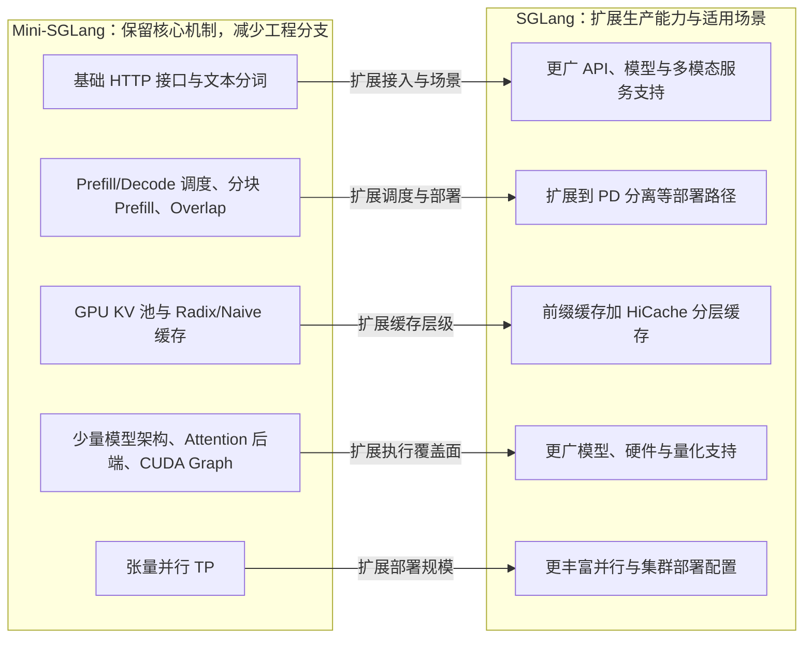

## KernelDriver · 第二期 Task 0 打卡

- 微信群昵称：**KernelDriver**
- GitHub ID：**KernelDriver-star**
- 环境：本地 NVIDIA RTX 5060 Ti，8GB 级显存；Windows + WSL2 Ubuntu 24.04
- AI 占比 vs 人工占比：未精确计时，AI 主导环境配置、实验执行、资料核对和本文整理；人工参与源码阅读、提问及概念练习。本文为 AI 辅助学习记录，不代表全部细节已独立掌握。
- 本次提交：**4.1–4.4**；4.5 安装完整版 SGLang 为选做，本次未做。
- 当前卡点：基础服务已跑通；缓存分配、调度预算和更深的 CUDA 实现还需后续任务继续学习。
- mini-sglang 实测提交：[`9a91cfafe754aa85daee49998176275667eb58f2`](https://github.com/sgl-project/mini-sglang/tree/9a91cfafe754aa85daee49998176275667eb58f2)。以下实现说明以此提交为准。

### 4.1 Mini-SGLang 模块职责

| 模块 | 职责 | 在一次请求中的作用 |
|---|---|---|
| `server` | 启动进程、解析参数、提供 HTTP API | `/v1/chat/completions` 接收输入和生成参数 |
| `tokenizer` | 文本编码、聊天模板处理及输出反分词 | 输入文本 → token ID；生成 token → 文本 |
| `message` | 定义进程之间传递的消息 | `TokenizeMsg`、`UserMsg`、`DetokenizeMsg`、`UserReply` 携带不同阶段的数据 |
| `core` | `Req`、`Batch`、`Context`、`SamplingParams` 等核心结构 | 表示请求状态、当前批次、执行上下文及生成参数 |
| `scheduler` | 请求接纳、组批、资源协调与执行调度 | 请求先排队，再选择 Prefill 或 Decode 批次 |
| `engine` | 初始化执行环境、驱动模型计算、CUDA Graph 和采样 | 根据批次执行前向，再从 logits 选择新 token |
| `models` | 具体模型网络以及权重加载、切分 | 把层组合成 Qwen、Llama 等模型 |
| `layers` | Embedding、Linear、Norm、RoPE 等计算组件 | 执行模型里的各类张量运算，部分层支持 TP |
| `attention` | 封装注意力后端和批次元数据 | 使用 FlashAttention、FlashInfer 或 TRT-LLM 后端 |
| `kvcache` | KV 存储池、Naive/Radix 缓存管理 | 保存历史 K/V，并支持公共前缀复用 |
| `distributed` | 张量并行通信封装 | 多卡之间的 All-Reduce/All-Gather 等通信 |
| `kernel` | 自定义 CUDA/Triton 内核与 JIT 支撑 | 实现底层计算或数据操作 |

请求流程图（逻辑角色，**不是每个方框对应一个独立进程**）：



本次源码阅读中理清的几点：

1. 消息序列化用于进程通信，不等于 Tokenization。`UserMsg` 只是数据对象，不会自己执行模型或解码文本。
2. 聊天列表先套模板；纯字符串走另一条分支；最终都通过 `encode()` 转为 token ID。
3. 有效 `UserMsg` 会先转成 `PendingReq` 加入等待列表。Scheduler 决定执行哪些请求，Engine 组织执行，Model 定义具体计算。
4. `Batch` 带有 `phase="prefill"` 或 `phase="decode"`，两者都进入 `Engine.forward_batch()`。Decode 可以通过 CUDA Graph 重放前向计算，而不必每轮再进入 Python 的 `model.forward()`。

依据：[官方结构文档](https://github.com/sgl-project/mini-sglang/blob/9a91cfafe754aa85daee49998176275667eb58f2/docs/structures.md)、[本次阅读的调度源码](https://github.com/sgl-project/mini-sglang/blob/9a91cfafe754aa85daee49998176275667eb58f2/python/minisgl/scheduler/scheduler.py)、[执行引擎源码](https://github.com/sgl-project/mini-sglang/blob/9a91cfafe754aa85daee49998176275667eb58f2/python/minisgl/engine/engine.py)。

### 4.2 从 Mini-SGLang 到 SGLang 的架构演进图

下面表示相同职责上的能力对照，不表示两个仓库逐文件对应，也不表示 Mini 没有生产引擎的核心优化。



Mini 已保留 Radix Cache、Chunked Prefill、Overlap Scheduling、TP 和多个 Attention 后端，适合沿一条请求理解系统。SGLang 面向更广的生产需求，增加相应配置和执行路径；具体支持情况取决于版本、模型与硬件。

资料：[Mini 功能说明](https://github.com/sgl-project/mini-sglang/blob/9a91cfafe754aa85daee49998176275667eb58f2/docs/features.md)、[SGLang 官方概览](https://docs.sglang.io/)、[HiCache](https://docs.sglang.io/docs/advanced_features/hicache)、[PD 分离](https://docs.sglang.io/docs/advanced_features/pd_disaggregation)、[量化](https://docs.sglang.io/docs/advanced_features/quantization)。

### 4.3 安装与实际推理验证

2026-10-27 完成独立环境安装并成功运行，2026-10-30 再次复测通过。沿用缓存的真实 `Qwen/Qwen3-0.6B` 权重，没有使用 dummy weights。

| 项目 | 实测配置 |
|---|---|
| Python / CUDA Toolkit | 3.12.3 / 13.0 |
| PyTorch | 2.9.1+cu130 |
| Transformers | 4.57.3 |
| FlashInfer / sgl-kernel | 0.7.2.post1 / 0.3.21 |
| 后端与精度 | FlashInfer，BF16，TP=1 |
| 启动限制 | 并发 2、最大序列 2048、Prefill 分块 512 |
| KV 配置 | page size 1、4096 个槽，K+V 约 0.44 GiB |

启动命令（`MODEL_DIR` 指向本地 Qwen3-0.6B snapshot，虚拟环境已激活）：

```bash
export CUDA_HOME=/usr/local/cuda
export PATH="$VIRTUAL_ENV/bin:$CUDA_HOME/bin:$PATH"
export HF_HUB_OFFLINE=1
export MAX_JOBS=4
export FLASHINFER_CUDA_ARCH_LIST=12.0
python -m minisgl --model "$MODEL_DIR" \
  --host 127.0.0.1 --port 1919 --attn fi \
  --max-running-requests 2 --max-seq-len-override 2048 \
  --max-prefill-length 512 --num-pages 4096 --cuda-graph-max-bs 2
```

验证：`GET /v1/models` 和 `POST /v1/chat/completions` 成功，依赖检查输出 `All installed packages are compatible`。

```text
请求：请用一句话介绍你自己。 /no_think
temperature=0, max_tokens=128, stream=false

回复（省略空 think 标签）：
我是AI助手，致力于帮助用户解决问题和获取信息。

finish_reason: stop
PASS: model endpoint and non-empty chat completion
```

复测单次请求用时 0.558 秒，仅作为功能验证，不作为吞吐或性能结论。接口 usage 字段为 0，因此没有用它推算真实 token 数。首次启动遇到 ninja 不在 PATH 的问题，在启动脚本加入虚拟环境 bin 路径后解决；既有 vLLM 环境未修改。

下图是根据本次真实 JSON 结果生成的**测试报告页面截图**，不是终端截图；提供原始请求/响应文件供核对。


[原始请求与响应 JSON](https://github.com/KernelDriver-star/mini-sglang-learning/blob/main/task0/inference-result.json) · [完整依赖版本](https://github.com/KernelDriver-star/mini-sglang-learning/blob/main/task0/requirements-frozen.txt) · [复测输出](https://github.com/KernelDriver-star/mini-sglang-learning/blob/main/task0/smoke-test-20261030.log)

### 4.4 高频概念：原理及解决的问题

**KV Cache**

- 问题：自回归生成时，每一步都需要历史上下文；从头重复计算历史 K/V 会产生冗余工作。
- 方法：保存各层历史 token 的 Key、Value，后续只计算新位置的 K/V，并读取历史缓存参与注意力计算。
- 代价：以显存换计算，缓存随上下文与并发增长；并非消除了读取历史或注意力计算。
- 区别：缓存的不是答案文本，也不是模型权重。

**Prefill / Decode**

- Prefill 处理输入提示词，建立 KV Cache；最后一个输入位置的结果可以用于采样首个回复 token。典型长输入场景偏计算密集。
- 普通 Decode 每条请求每轮处理刚生成的新 token，结合历史 KV 产生下一 token 的分数。小批量时常偏显存带宽密集。
- 分阶段有助于识别不同瓶颈，并采用分块 Prefill、不同 Attention 后端或不同部署方式；上述瓶颈是趋势，不是所有场景下的绝对结论。
- `forward()` 输出 logits，采样选 token。一个批次可以同时处理多个请求；不是整个服务一次只能生成一个 token。

```text
Prefill：输入提示词 → logits → 采样出 A
Decode：输入 A + 历史 KV → logits → 采样出 B
Decode：输入 B + 历史 KV → logits → 采样出 C
```

**Continuous Batching**

- 问题：请求输入和输出长度不同；固定一批请求等全部结束，会增加后续请求等待并浪费执行机会。
- 方法：按迭代调整参与执行的请求集合，完成请求退出，等待请求在资源和调度条件允许时加入后续执行。
- 例子：A、B 正在生成，A 先结束，C 不必总等到 B 全部结束才有机会执行。
- 本次 Mini 源码优先尝试 Prefill 批次，否则选择 Decode 批次。Continuous Batching 不要求同一个批次一定混合两种阶段，也不保证新请求立即被接纳。

**RadixAttention / Radix Cache**

- 问题：多个请求共享系统提示词、对话历史或 few-shot 前缀时，重复 Prefill 会重复计算相同前缀。
- 方法：用基数树组织前缀与对应 KV 的关联，匹配可复用前缀，对未命中的后缀继续计算，并通过锁定和回收管理缓存生命周期。
- 例子：两个请求都以同一段“你是一位中文助教……”开头，这段完全相同的 token 前缀可以复用，而不是重算全部输入。
- 区别：这是复用前缀计算结果，不是复制旧答案；文本语义相似不意味着 token 前缀相同。实际收益与命中率、请求长度及资源有关，本次未做缓存收益压测。

个人后续学习重点：将数据消息与执行函数分清，区分 forward 与采样、Prefill 等待请求与正在 Decode 的请求，再逐步深入缓存预算与分块调度。
