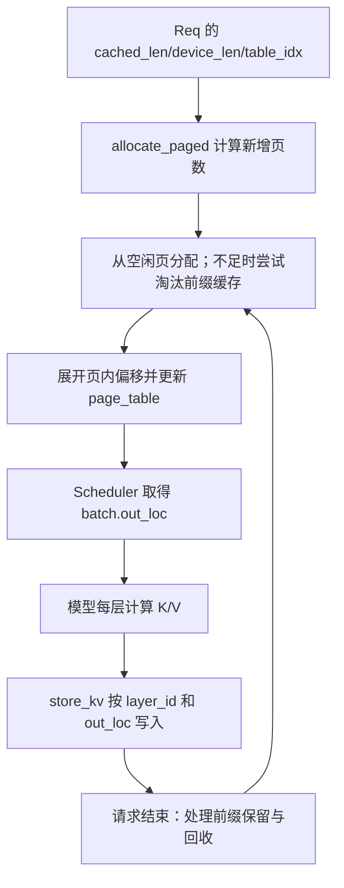
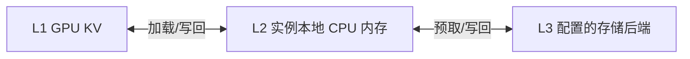
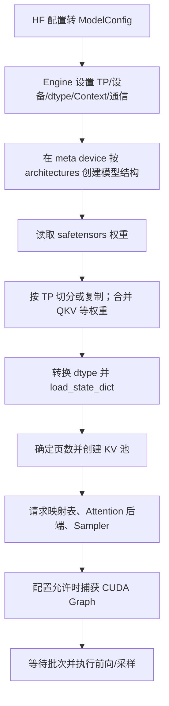
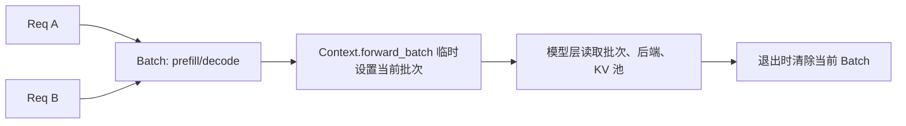
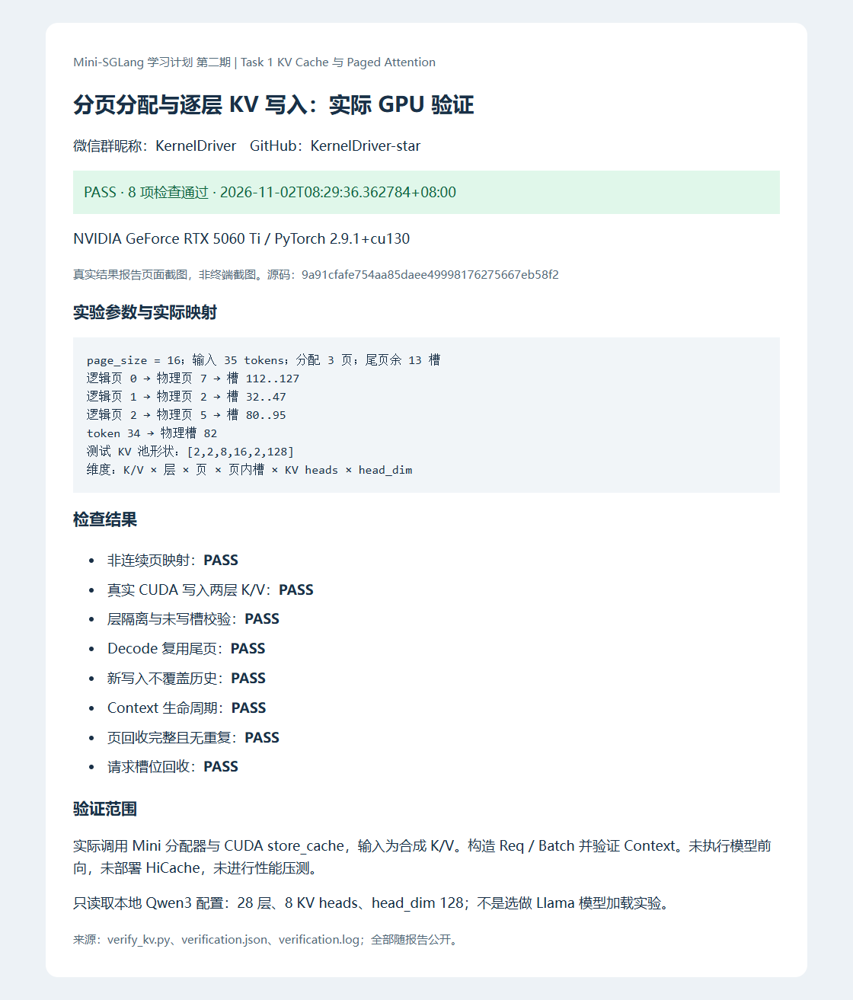

## KernelDriver · 第二期 Task 1：KV Cache 与 Paged Attention

- 微信群昵称：**KernelDriver**；GitHub：**KernelDriver-star**。
- 环境：本地 RTX 5060 Ti 8GB / WSL2 Ubuntu / Python 3.12.3 / PyTorch 2.9.1+cu130 / CUDA Toolkit 13.0。
- AI 占比 vs 人工占比：未精确计时；AI 主导资料核对、实验执行和本文整理；人工参与分页例题、源码阅读及讨论。本文不代表全部实现已独立掌握。
- 完成必做 **4.1、4.2**，另附真实 Mini 分配器与 CUDA 写入验证；未做选做 4.3 的 Llama 加载实验。
- 当前卡点：本地实验通过；HiCache 为资料对照分析，未部署。
- Mini 版本：[`9a91cfafe754aa85daee49998176275667eb58f2`](https://github.com/sgl-project/mini-sglang/tree/9a91cfafe754aa85daee49998176275667eb58f2)。

### 4.1 KV Cache 内存布局与分层设计对比

#### 职责对照

| 职责 | 本次 Mini 版本 | SGLang 对应概念 |
|---|---|---|
| 物理存储 | `MHAKVCache` 的 GPU 张量 | KV Pool / KVCache，布局随模型与后端变化 |
| 请求位置映射 | `page_table[table_idx, position]`；TableManager 管理请求行 | ReqToTokenPool |
| 位置分配与回收 | `scheduler/cache.py` 的 CacheManager | TokenToKVPoolAllocator 等分配器 |
| 公共前缀复用 | RadixPrefixCache / NaivePrefixCache | Radix Tree 组织前缀与 KV 位置关联 |

本机相关目录没有题目所称的同名 `BlockAllocator`，实际阅读 `CacheManager.allocate_paged/_allocate/_free`。上述是职责层次，不是 HiCache 的 L1/L2/L3 存储层级。

SGLang 依据：[memory_pool.py](https://github.com/sgl-project/sglang/blob/main/python/sglang/srt/mem_cache/memory_pool.py)；main 会演进，本文不假设类名永久不变。

#### Mini 布局与分页例子

`MHAKVCache` 预先分配的张量形状：

```text
[2, num_layers, num_pages, page_size, local_kv_heads, head_dim]
 K/V   模型层      页数        页内槽       本卡KV头数      每头维度
```

各层拥有各自 K/V，写入通过 layer_id 和物理 token 槽定位。本版 page_table 实际存储每个 token 的物理槽位，而不只是页号。物理槽位 = 物理页号 × page_size + 块内偏移。

```text
35 tokens，page_size=16 → ceil(35/16)=3 页，尾页剩13槽
逻辑页0 → 物理页7 → 槽112..127
逻辑页1 → 物理页2 → 槽32..47
逻辑页2 → 物理页5 → 槽80..95
token 34（从0计数）→ 逻辑页2，偏移2 → 物理槽82
```

这是池内页管理，不是每页重新调用一次显存分配。池可以是连续张量，请求获得的页位置不必连续。分页缓解连续分配限制与过量预留；尾页仍可能产生内部碎片，并非没有开销。

#### 分配、写入、回收



1. `allocate_paged()` 按 `ceil(device_len/B)-ceil(cached_len/B)` 计算新增页数。继续生成但未跨页边界时，复用尾页。
2. `_allocate()` 从 free_slots 取页，必要时调用前缀淘汰。available_size 是空闲及可淘汰的 token 槽容量，不是显存字节数。
3. `_page_to_token()` 展开页内位置，`_write_page_table()` 写入请求到物理槽映射。
4. `store_kv(k,v,out_loc,layer_id)` 调用 `store.cu` 真正写入各层缓存；分配位置和写入数据是两个步骤。
5. 请求结束不等于全量 KV 立即丢弃：Radix 可以保留前缀，锁保护正在使用的数据；`cache_req()` 处理重复缓存及尾部回收。Naive 不保留前缀。
6. `_free()` 把页起始槽归还空闲列表，不代表清零或释放整个 GPU 池。请求行由 `TableManager.free()` 单独归还。

源码：[CacheManager](https://github.com/sgl-project/mini-sglang/blob/9a91cfafe754aa85daee49998176275667eb58f2/python/minisgl/scheduler/cache.py)、[KV 池](https://github.com/sgl-project/mini-sglang/blob/9a91cfafe754aa85daee49998176275667eb58f2/python/minisgl/kvcache/mha_pool.py)、[CUDA store 内核](https://github.com/sgl-project/mini-sglang/blob/9a91cfafe754aa85daee49998176275667eb58f2/python/minisgl/kernel/csrc/jit/store.cu)。

#### HiCache 增加的工程考量

HiCache 的 L1 是 GPU 显存，L2 是实例本地 CPU 内存，L3 是存储后端。L3 是否跨实例共享取决于配置；L2 不等于跨机器共享内存。低层命中的 KV 需要搬入 GPU 才用于计算。[官方设计](https://docs.sglang.io/docs/advanced_features/hicache_design)



以下是结合分层设计作出的工程分析，不是本次测量：

| 方面 | 相比 GPU 内部分配新增的问题 |
|---|---|
| 传输成本 | 节省重算的时间是否超过搬运开销？ |
| 异步调度 | 何时预取、等待多久、传输完成后何时可读取？ |
| 淘汰与容量 | 如何协调各层容量、保留和写回策略？ |
| 正确性 | 如何跟踪位置、有效性和使用状态，避免提前回收？ |
| 故障与共享 | 存储超时如何回退，共享数据如何保证模型/格式兼容？ |
| 布局与观测 | 计算与搬运对布局需求不同，需要观察命中率、I/O、等待及 TTFT |

### 4.2 模型加载过程和核心数据结构

#### 模型加载



meta 阶段先描述结构，不存放真实权重数据。权重来自模型文件；KV Cache 随请求计算写入，二者不能混为一谈。已有 Task 0 记录验证了真实 Qwen3-0.6B 的启动和推理。

源码：[Engine](https://github.com/sgl-project/mini-sglang/blob/9a91cfafe754aa85daee49998176275667eb58f2/python/minisgl/engine/engine.py)、[权重加载器](https://github.com/sgl-project/mini-sglang/blob/9a91cfafe754aa85daee49998176275667eb58f2/python/minisgl/models/weight.py)。

#### 数据结构关系

| 对象 | 主要内容与职责 |
|---|---|
| Req | uid、CPU input_ids、table_idx、cached_len、device_len、生成参数、缓存句柄；表示一条请求的进度 |
| Batch | Req 列表、phase、input_ids、positions、out_loc、Attention 元数据；表示本轮执行，部分字段由调度器补齐 |
| Context | page_table、KV 池、Attention/MoE 后端和当前 Batch；为模型层提供执行上下文 |



Req.complete_one() 更新缓存与设备长度；普通 Decode 的新增处理长度可为1。Context 不是模型权重仓库，Batch 也不是永久绑定的一组请求。依据：[core.py](https://github.com/sgl-project/mini-sglang/blob/9a91cfafe754aa85daee49998176275667eb58f2/python/minisgl/core.py)。

### 实际验证与截图

2026-11-02 在 RTX 5060 Ti 运行验证脚本，实际调用 Mini 分配器和 CUDA store_cache。8 项检查全部通过：非连续页映射、两层 K/V 写入、层隔离与未写槽、Decode 复用尾页、历史数据保持、Context 生命周期、页回收无重复、请求槽回收。

输入是小型合成 K/V，使用 Naive 策略；构造真实 Req/Batch/Context。本实验不运行模型 forward，不测试 Radix 淘汰或 HiCache，也不做性能压测。只读取 Qwen3 配置（28层、8 KV heads、head_dim=128），未把它当作选做 Llama 加载任务。

本实验 page_size=16；原 Task 0 FlashInfer 服务仍使用 page_size=1，没有把不支持的页大小强加给该 Attention 后端。测试中 K/V 按内核要求传入二维 token×特征张量。



截图是实际结果 JSON 渲染后的报告页面，不是终端截图。核对：[测试脚本](https://github.com/KernelDriver-star/mini-sglang-learning/blob/main/task1/verify_kv.py)、[原始结果](https://github.com/KernelDriver-star/mini-sglang-learning/blob/main/task1/verification.json)、[运行日志](https://github.com/KernelDriver-star/mini-sglang-learning/blob/main/task1/verification.log)。
